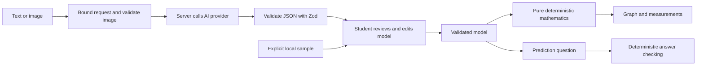

# Architecture and student reading guide

```text
src/
  app/
    api/interpret/route.ts       Request validation and server credentials
    globals.css                 Notebook layout and responsive styles
    layout.tsx                  Root HTML and metadata
    page.tsx                    Landing page
  components/
    problem-input.tsx           Text/image form, consent, and network failures
    problem-workbench.tsx       Review/explore/prediction view transitions
    model-review.tsx            Editable parameters and assumption notes
    projectile-simulator.tsx    SVG and native keyboard-operable sliders
    linear-simulator.tsx        Numeric drafts and Recharts plot
    prediction.tsx             Answer entry and deterministic feedback
    ui/button.tsx              Editable shadcn/ui-style Button
  lib/
    models.ts                  Strict Zod contracts and explicit sample models
    math.ts                    Deterministic mathematical functions
    upload.ts                  Shared public input limits
    interpretation.ts         Server-side AI adapter and bounded upload decoding
    utils.ts                   CSS class composition
tests/                         Vitest mathematics, contract, provider, route tests
e2e/                           Playwright desktop/mobile and axe checks
.github/workflows/ci.yml        Reproducible checks; not yet run remotely
```

## Data boundary



AI suggests data; it supplies no executable logic. TypeScript types are inferred from runtime Zod schemas, so the network boundary and UI share one contract.

## TypeScript model shapes

```ts
type Projectile = {
  type: 'projectile_motion';
  velocity: number; // 0 to 100 inclusive
  angle: number; // 0 to 90 inclusive
  gravity: number; // 0.1 to 30 inclusive
  velocityUnit: 'm/s';
  angleUnit: 'deg';
  gravityUnit: 'm/s^2';
  assumptions: string[];
};
type Linear = {
  type: 'linear_function';
  slope: number; // -100 to 100 inclusive
  intercept: number; // -1000 to 1000 inclusive
  xUnit: 'unitless';
  yUnit: 'unitless';
  assumptions: string[];
};
type Interpretation =
  { status: 'supported'; problem: Projectile | Linear } | { status: 'unsupported'; reason: string };
```

The types above explain the contract; `src/lib/models.ts` is authoritative. Unknown properties, nonfinite values, other units, and other problem types are rejected. Assumption notes are bounded in count and length. They do not override the simulator's fixed physics.

## State ownership

The workbench owns the draft model, confirmed model, prediction state, and pending state. Numeric input components retain temporary text while applying only valid numbers to the model. A failed interpretation preserves current work. Pending requests pause competing controls. Every variable change resets prediction feedback. Focus moves to the new heading when changing views, not on each variable update.

## What verification proves

Known-answer tests independently check projectile equations, endpoint cases, complementary angles, linear values, and rounding tolerance. Schema tests reject invalid contracts. Provider tests exercise successful, unsupported, malformed, truncated, and unavailable responses using stubs. Route tests verify actual multipart parsing, consent, decoding, and server-side request construction.

Browser tests run on the production build for desktop and emulated mobile Chromium. They test review, edits, slider keyboard operation, predictions, network failure recovery, pending states, and preservation of current work. Automated axe scans cover the main views. None of these substitute for real screen-reader testing, physical-device testing, or live AI accuracy evaluation.
